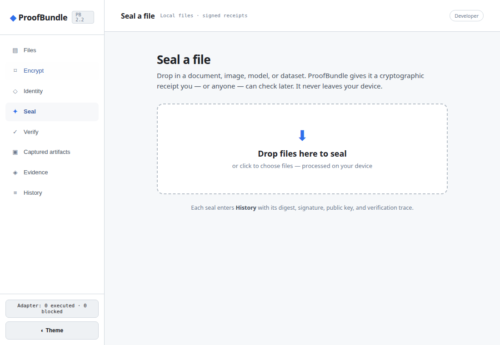

# ProofBundle

A local application for files, signed receipts, encryption, and verifiable history.

[Open the application](https://proofbundle.org/proofbundle.html) · [Website](https://proofbundle.org) · [Cryptographic basis](CRYPTOGRAPHIC_BASIS.md) · [Test receipts](reports/native-repair-20261013/) · [Security](SECURITY.md)



Open [`proofbundle.html`](proofbundle.html) in a modern browser. The standalone file embeds its cryptographic engine; ordinary file sealing, verification, local identity registration, and encryption require no server or Node runtime. Originals and source records remain separate from the receipts derived from them.

## The application

- **Files:** select a folder through the browser's permission boundary, or use the folder-upload fallback. Prepare receipts for selected files and retain their relative paths.
- **Seal and verify:** sign commitments over canonical JSON, download portable receipts, and inspect typed verification results and custody history.
- **Identity:** persist a local Ed25519 recorder key, export its public identity and signed AI-BOM, or register a distinct agent session locally. Registration records its actual time and supplied metadata; it does not retroactively establish spawn-time identity.
- **Encryption:** ML-KEM-512/768/1024 with HKDF-SHA-256 and either AES-256-GCM or ChaCha20-Poly1305. The file workflow verifies the signed outer receipt and authenticates the encrypted payload before releasing plaintext. It reads one selected file into memory. The separate `PB-VAULT-1` implementation handles streaming vault records.
- **History and evidence:** retained bytes, source records, declarations, executed tests, signatures, and external attestations have separate states.

The optional [web bridge](agent/WEB-BRIDGE.md) serves this same application at `/app` or `/proofbundle.html`, with a companion console for an already configured local relay. Node remains an optional transport/development tool; it supplies no cryptographic computation to the repaired production paths. OS entropy comes from `crypto.getRandomValues`; digest, signature, KEM, key derivation, and authenticated encryption computations use embedded source implementations.

## Cryptographic basis

The [basis ledger](CRYPTOGRAPHIC_BASIS.md) lists normative sources, exact implementations, conformance evidence, and remaining proof obligations. [`CRYPTO_SOURCE_MANIFEST.json`](CRYPTO_SOURCE_MANIFEST.json) identifies source bytes embedded in the HTML. [`CRYPTOGRAPHIC_BASIS.json`](CRYPTOGRAPHIC_BASIS.json) provides the machine-readable ledger.

The pinned [NIST ACVP sample corpus](vectors/nist-acvp/SOURCE_MANIFEST.json) exercises all three ML-KEM and ML-DSA parameter sets: **855 cases pass**. Separate tests cover SHA-2, Keccak/SHA-3/SHAKE, BLAKE, RFC 6979 deterministic ECDSA, RFC 8439 ChaCha20/Poly1305, AES-256/GCM, interoperability, canonical-input rejection, signature tampering, streaming hashes, and relay envelopes.

These are scoped test results, not blanket proofs or FIPS certification. The Lean audit covers eight abstract interface/model theorems without axiom dependencies; it does not prove refinement of the JavaScript crypto. JavaScript timing resistance, primitive refinement, and full protocol-composition proofs remain open. Falcon and SLH-DSA compatibility providers remain bundled third-party implementations and are identified separately from scratch providers.

OTS calendar submission is a pending external commitment. A Bitcoin attestation displayed by `ots info` becomes verified only after successful detached-file verification against Bitcoin evidence. The ordinary standalone browser does not require an OTS service and does not manufacture anchored status.

## Reproduce the checks

Node is used here as a test runner and, in designated test files, as an independent crypto oracle.

```sh
npm ci
npm run selftest
npm run test:surface
node crypto/t_native_profile.mjs
node scripts/verify-nist-acvp.mjs
node scripts/verify-rfc6979.mjs
npm run test:html-crypto
cd lean
lake build ProofBundle Architecture
lake env lean NativeBasisAudit.lean
```

Rebuild the standalone application after changing its native sources:

```sh
node scripts/embed-native-crypto.mjs
python3 scripts/connect-native-crypto.py
python3 scripts/embed-browser-workspace.py
```

Historical formal work, registries, source archives, and earlier audits remain in the repository and its history. Their presence does not establish that every declaration is implemented, that every archived test was rerun, or that a model-written requirement was adopted by the operator.

## License

GPL-3.0-or-later. See [LICENSE](LICENSE). Retained third-party code keeps its applicable notices.

Optional browser workflow checks use Chrome and `playwright-core` as development tools:

```sh
npm install --no-save playwright-core
node test/browser/native-workflows.mjs
node test/browser/bridge-workflows.mjs
```

`PB_CHROME` selects the Chrome executable; `PB_QA_ROOT` selects persistent QA storage. The bridge check uses an isolated state directory and port 18790. Local browser keys are tied to the browser's storage origin; clearing that storage removes them. Keep deliberately exported recipient decryption keys when encrypted files must remain recoverable.
